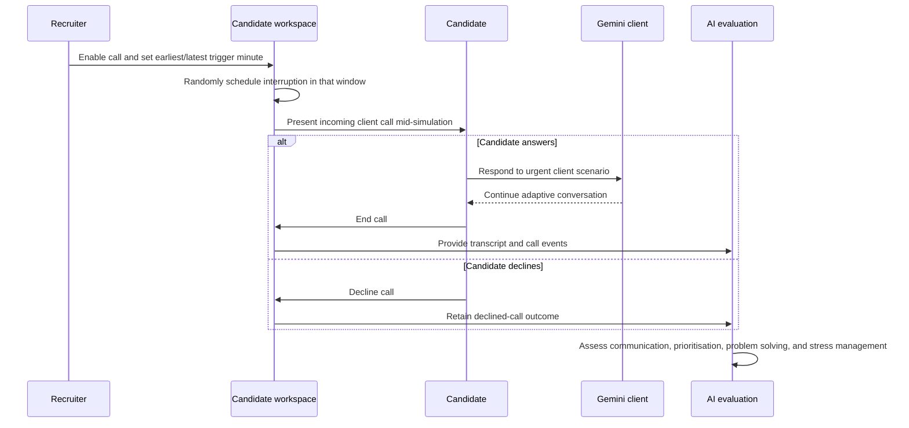
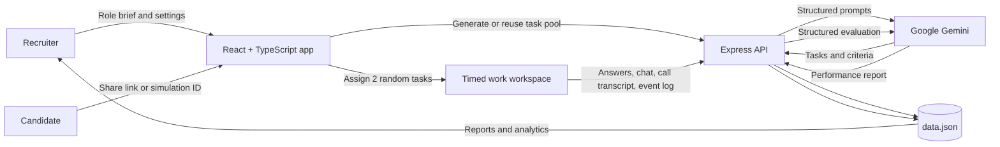
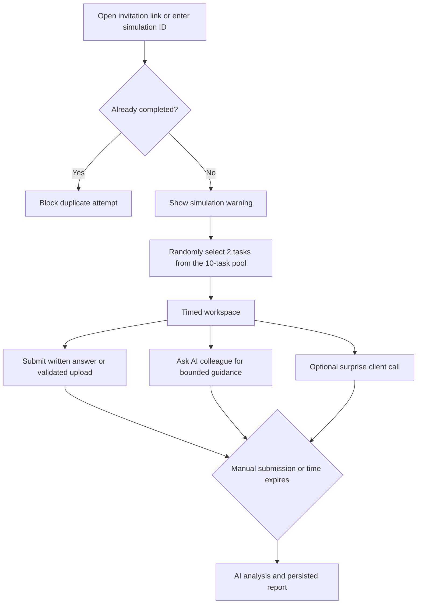
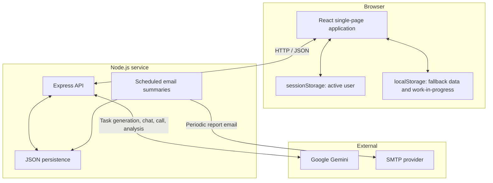

# SimuHire — AI-Powered Work Simulation Platform

> Turn a job description into a realistic work simulation, measure how candidates respond to normal work and unexpected pressure, and receive an AI-assisted hiring report.

## 🚀 Live Demo

> **Try SimuHire in Google AI Studio:** [Open the live demo](https://ai.studio/apps/6c8c3d72-1938-4a2a-a177-b1eedc0d3aba)

SimuHire is a full-stack recruiting prototype for assessing practical capability beyond a résumé or generic quiz. Recruiters create a role-specific, time-boxed simulation; candidates complete a randomly assigned subset of work; and Gemini evaluates submitted work, communication, pacing, and behaviour to create a structured performance report.

## Signature capability: the unexpected client call

**SimuHire’s differentiator is an AI-powered client call that interrupts a candidate while they are working.** It recreates a realistic moment from professional life: an urgent stakeholder request appearing mid-task, with ambiguity, time pressure, and the need to communicate clearly.

The recruiter can enable the scenario and define a valid trigger window. SimuHire randomly selects a moment within that window, displays an incoming call, and lets the candidate answer or decline. When answered, Gemini plays the client, dynamically responding to what the candidate says. The conversation transcript and call events become part of the final assessment.



## Product at a glance

| Area | What it does |
| --- | --- |
| Recruiter workspace | Creates simulations from a job title, description, duration, tools, and optional client-call configuration. |
| AI task design | Generates ten distinct, role-relevant tasks across text, image, audio, and video submissions. It can include source assets such as email threads, documents, infographics, and spreadsheet-style data. |
| Template library | Saves reusable simulation templates, making recurring roles faster and more consistent to assess. |
| Candidate experience | Randomly assigns two tasks, tracks time, preserves in-progress work locally, validates uploads, and prevents a duplicate attempt for the same candidate and simulation. |
| AI assistance | Provides a bounded “senior colleague” chat that guides thinking without giving task answers. |
| Evaluation | Synthesizes work, task criteria, chat history, client-call transcript, events, and timing into scores and a `HIRE`, `CONSIDER`, or `NO_HIRE` recommendation. |
| Analytics and reporting | Gives recruiters performance reports, historical simulation data, and optional scheduled SMTP summary emails. |

## End-to-end workflow



### Recruiter flow

1. Sign in as a recruiter and enter the job title, job description, duration, and client-call settings.
2. Generate a **ten-task pool** with Gemini, or load a reusable template.
3. Review, refine, group, regenerate, add, or remove tasks; obtain AI-suggested evaluation criteria where needed.
4. Save the simulation and share the generated `?simId=...` link with candidates.
5. Review candidate performance reports and portfolio-level analytics.

### Candidate flow



The candidate workspace accepts the following uploads:

| Type | Accepted formats | Limit |
| --- | --- | ---: |
| Image | JPEG, PNG, GIF, WebP | 10 MB |
| Audio | MP3, WAV, OGG, WebM | 25 MB |
| Video | MP4, WebM, QuickTime | 100 MB |

## Evaluation model

The performance analysis does not evaluate an answer in isolation. It receives:

- completed task answers, supplied task assets, and evaluation criteria;
- the AI-colleague chat history;
- the client-call transcript or declined-call result;
- event logs for task edits, submissions, chats, and client-call start/end;
- total time, time taken, and whether the session was submitted manually or automatically.

It returns a report containing an overall summary, strengths, areas for improvement, 1–10 scores for problem solving, communication, and stress management, a suitability score, and a hiring recommendation with reasoning.

> **Current implementation detail:** text submissions are sent to the evaluator. Image, audio, and video submissions are evaluated by file name/type and task-fit assumptions—the server does not inspect media contents.

## Architecture



### Frontend responsibilities

| File | Responsibility |
| --- | --- |
| `App.tsx` | Role-based navigation, active state, simulation startup, task assignment, and report persistence. |
| `components/RecruiterDashboard.tsx` | Simulation creation, template reuse, AI task curation, invite link generation, and analytics. |
| `components/CandidateWorkspace.tsx` | Timer, autosave, task submission, upload checks, event logging, and client-call scheduling. |
| `components/ClientCallModal.tsx` | The conversational, pressure-scenario interruption. |
| `components/PerformanceReport.tsx` | Recruiter-facing scorecard and recommendation report. |
| `services/geminiService.ts` | Typed client wrapper for Express AI endpoints. |

### Backend responsibilities

`server.js` serves the Vite application in development and the production build in deployment. It also persists simulations, reports, and templates to `data.json`; defines JSON schemas for Gemini’s structured outputs; and exposes routes for task generation/refinement, evaluation, chat, client calls, and support.

When SMTP settings are configured, a `node-cron` job produces a report summary every ten minutes. The current recipient is hard-coded in `server.js`; this is appropriate only for demonstration and should be made recruiter-specific before deployment.

## API overview

| Endpoint group | Purpose |
| --- | --- |
| `GET /api/data` | Load persisted simulations, reports, and templates. |
| `POST /api/simulations`, `POST /api/reports` | Save simulations and completed performance reports. |
| `POST /api/templates`, `DELETE /api/templates/:id` | Save and remove reusable simulation templates. |
| `POST /api/generate-tasks`, `/modify-tasks`, `/regenerate-single-task`, `/generate-single-task` | Create and refine work-simulation tasks. |
| `POST /api/group-tasks`, `/suggest-criteria` | Organize task pools and obtain measurable evaluation criteria. |
| `POST /api/analyze-performance` | Produce the structured candidate assessment. |
| `POST /api/chat-response`, `/client-call-response`, `/support-chat-response` | Power candidate guidance, the interruption scenario, and product support. |

## Technology stack

- **Frontend:** React 19, TypeScript, Vite, Tailwind CSS
- **Backend:** Node.js, Express
- **AI:** Google Gen AI SDK (`@google/genai`)
- **Persistence:** JSON file with browser-storage fallback
- **Automation:** Nodemailer and node-cron
- **Validation/testing:** JSON response schemas, TypeScript checks, Jest

## Run locally

### Prerequisites

- Node.js 18 or newer
- A Google Gemini API key
- SMTP credentials only for scheduled email summaries

```bash
git clone https://github.com/eshwarpotturi/Simuhire.git
cd Simuhire
npm install
```

Create `.env.local`:

```dotenv
GEMINI_API_KEY=your_gemini_api_key
SMTP_HOST=smtp.gmail.com
SMTP_PORT=587
SMTP_USER=your_email@gmail.com
SMTP_PASS=your_email_app_password
```

> **Configuration note:** the server reads `process.env` but does not currently call `dotenv.config()`. Export variables before starting, or add dotenv loading to `server.js` as a follow-up improvement.

```bash
set -a; source .env.local; set +a
npm run dev
```

Open [http://localhost:8080](http://localhost:8080). The port can be changed with `PORT`.

```bash
npm run lint     # Type-check
npm test         # Run Jest tests
npm run build    # Build the frontend
npm start        # Start Express
```

## Production considerations

SimuHire is an impressive workflow prototype, but real hiring use requires stronger foundations:

1. Replace browser-based demo authentication with secure identity, hashed passwords, server sessions, and role-based access control.
2. Replace shared `data.json` persistence with a database, tenant isolation, and concurrency-safe writes.
3. Use signed, expiring candidate invitations and server-side attempt controls.
4. Store uploads securely, scan them, and be transparent about any automated media assessment.
5. Move email recipient selection and all operational configuration out of source code.
6. Add human review, calibration, auditing, privacy safeguards, and fairness testing before AI recommendations influence hiring decisions.

## Portfolio highlights

SimuHire demonstrates full-stack TypeScript development, structured generative-AI workflows, two-sided product design, event-aware assessment UX, reusable template systems, and responsible documentation of the gap between a compelling prototype and a deployable hiring product.

## License

No license file is currently included. Add one before distributing or accepting external contributions.
